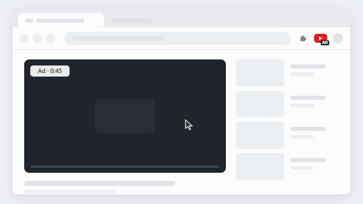
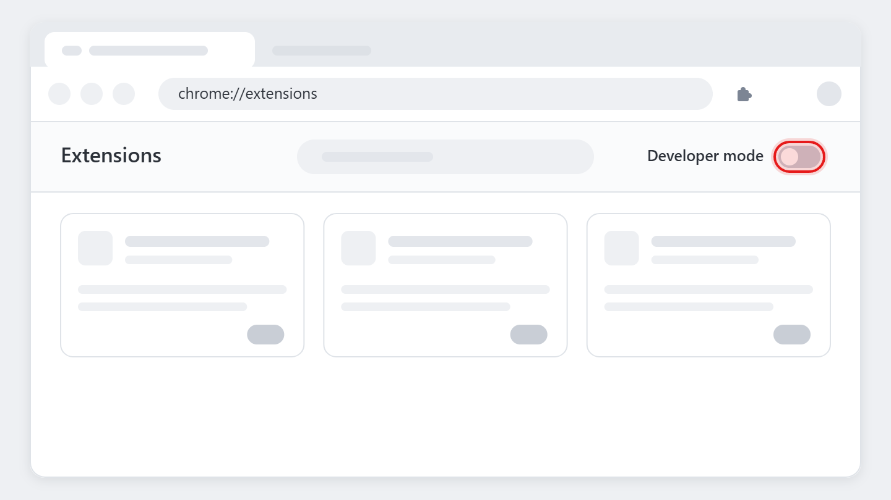
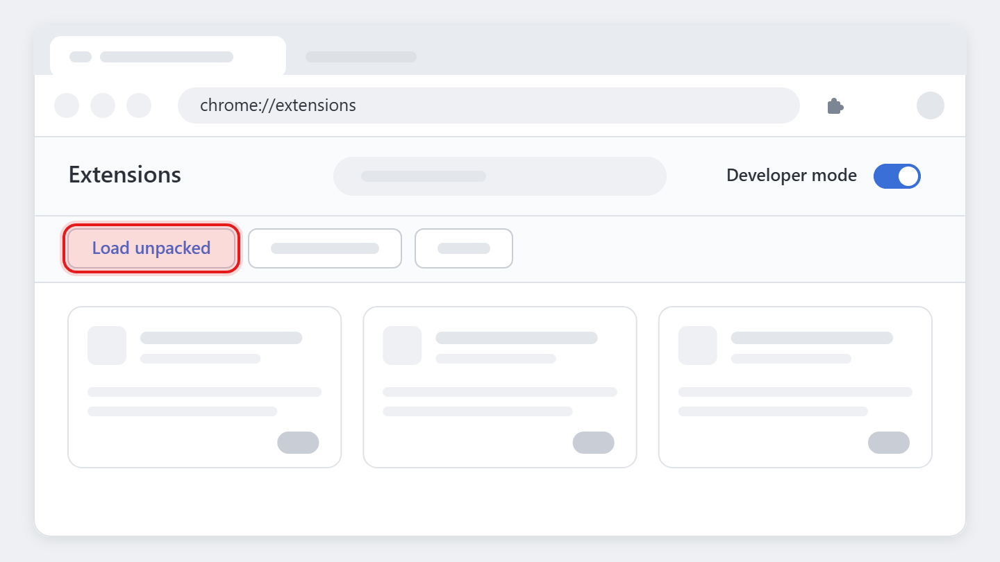
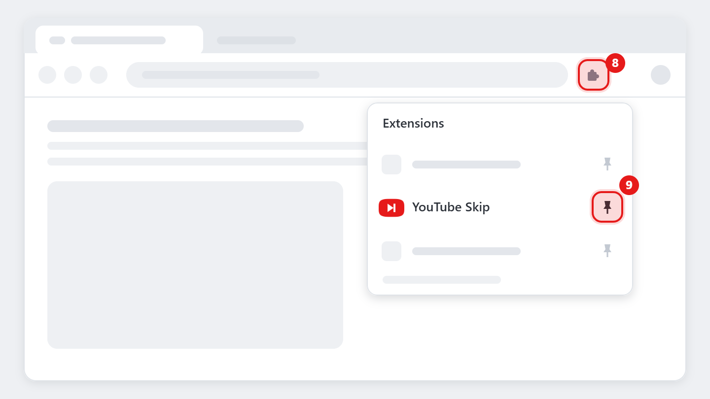

# YouTube Skip

<a href="https://github.com/vviseguy/youtube-skip/releases/latest/download/youtube-skip.zip"></a>

For ads, slow intros, and that one scene you'd rather skip this time. Get through them in a click.



Each click (or Alt+S) plays about 15 seconds of video in under a second. Clicks add together.

It works in Chrome, Edge, and Brave on a computer. It works on YouTube, Prime Video, and most other video sites. It does not work on live streams.

It does not block ads. The ads still play, only faster. It collects no data. It is not affiliated with YouTube or Google.

## Install

The extension is not in the Chrome Web Store. You add it by hand.

### Get the files

1. Download [youtube-skip.zip](https://github.com/vviseguy/youtube-skip/releases/latest/download/youtube-skip.zip).
2. Unzip the file.
   - On Windows, right-click the file and select **Extract All**.
   - On a Mac, double-click the file.
3. Move the unzipped folder to a permanent location, such as Documents.

   > **Important:** If you move or delete this folder later, the extension stops working.

### Add it to Chrome

4. In the address bar, type `chrome://extensions` and press Enter.
   In Edge, type `edge://extensions`.
5. At the top right of the page, turn on **Developer mode**.

   

6. Click **Load unpacked**.

   

7. Select the unzipped folder. This is the folder that contains `manifest.json`.
   YouTube Skip appears in the list of extensions.

### Pin the button

8. At the top right of the browser, click the puzzle-piece icon.
9. Next to **YouTube Skip**, click the pin.

   

   The YouTube Skip button appears in the toolbar.

### Finish

10. Refresh any YouTube tabs that are open.

**About Chrome's messages:**

- Chrome says the extension can "read and change your data on youtube.com". The extension needs this to detect ads and change the speed. On other sites, it does nothing until you click it.
- Chrome can show a notice about developer mode extensions when it starts. This is normal for extensions that you add by hand. You can close it.

## How to use it

### Speed through an ad

Click the button (or press Alt+S) once per 15 seconds of ad that you want to skip. For example, click 3 times for a 45-second ad.

### Skip part of any video

Click the button once to skip about 15 seconds. Click again to skip more. This works on most video sites, not only YouTube.

| Clicks | 1 | 2 | 3 | 4 |
|---|---|---|---|---|
| Video skipped | about 14 s | about 29 s | about 43 s | about 58 s |

Each click adds 0.9 seconds at 16x speed. It does not matter how fast you click.

### Read the button

| | Meaning |
|---|---|
|  | Ready. |
|  | A YouTube ad is playing. |
|  | Playing at 16x. The level shows the time that remains. |
|  | A YouTube ad is playing at 16x. Click to stop. |

The first click fills the icon about a quarter. Each further click adds a little less.

### Let YouTube ads speed up by themselves

1. Right-click the button and select **Options**.
2. Under **YouTube ads**, select a setting.

| Setting | During a YouTube ad |
|---|---|
| **Indicator** (default) | The button shows AD. You click as usual. |
| **Click to start** | One click plays the whole ad at 16x. Normal speed returns when the ad ends. |
| **Automatic** | Each ad plays at 16x by itself. To play an ad at normal speed, click the button. |

In Click to start and Automatic, a click during an ad starts or stops the speed-up. It does not add time.

### Turn off the animation

The water in the icon moves and bubbles. To turn this off, clear **Waves and bubbles** in **Options**. The icon still fills and drains.

## Updating

The extension does not update itself. To install a new version:

1. Download the zip again.
2. Unzip it and replace the files in your folder.
3. In `chrome://extensions`, click the reload arrow on **YouTube Skip**.

<details>
<summary><strong>Troubleshooting</strong></summary>

- **The button is not visible.** Pin it (Install, steps 8 and 9).
- **There is no Options menu.** You have an older version. See Updating.
- **AD never appears on YouTube.** Refresh the tab. If AD still does not appear, YouTube may have changed its page. Please [open an issue](https://github.com/vviseguy/youtube-skip/issues).
- **Alt+S does nothing.** Another extension may use the same shortcut. To change it, go to `chrome://extensions/shortcuts`.
- **The button shows "–".** Chrome does not let extensions run on its own pages, such as the New Tab page. Use the button on a video page.
- **Nothing happens on a live stream.** This is expected. Live video cannot play faster.
- **Nothing happens on another site.** The site may not use a standard video player.

</details>

<details>
<summary><strong>For developers</strong></summary>

The extension is plain JavaScript in [`extension/`](extension). It has no build step. Ad detection uses the `ad-showing` class on YouTube's player element ([`ads.js`](extension/ads.js)).

To release a new version:

1. Change `"version"` in `extension/manifest.json`.
2. Commit the change.
3. Tag and push:

   ```bash
   git tag v1.3.4 && git push origin main v1.3.4
   ```

The `release` workflow zips `extension/` and attaches `youtube-skip.zip` to a GitHub Release. It also draws the download button for that version (`tools/make-button.py`, font: Inter) and attaches it as `download.png`. The workflow fails if the tag does not match the manifest version.

The README images come from the extension's own icon code. To rebuild them:

1. Run `node tools/serve.mjs` and open the page that it prints.
2. Click **Save all images**.
3. Run `python tools/make-images.py`.

</details>

## License

MIT
